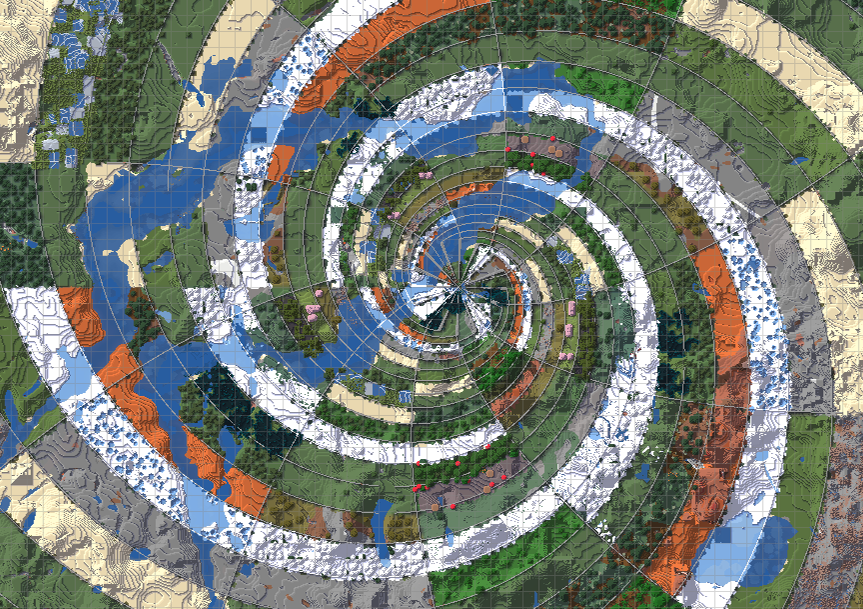

# Logarithmic Spiral Biome

Minecraft Forge/Fabric/NeoForge 1.20.1/1.20.4/1.20.6/1.21.1/1.21.4/1.21.11/26.1/26.3 mod that generates Overworld and Nether biomes in a logarithmic spiral pattern.

## Features

- Adds a `Logarithmic Spiral` world preset.

### Added in v1.1.0

- Nether dimension spiral support (with independent toggles for Overworld and Nether).
- In-game customization screen with real-time 2D map preview (accessible via the Customize button).
- Configurable spiral styles (Standard, Golden Ratio, Tight, Loose, Custom), scale, and growth rate sliders.
- Customizable boundary divider blocks with searchable block picker and adjustable wall height (flat paving or 1–5 block walls).
- Seamless compatibility with major biome mods (Terralith, Incendium, Biomes O' Plenty, Promenade, TerraBlender, etc.).
